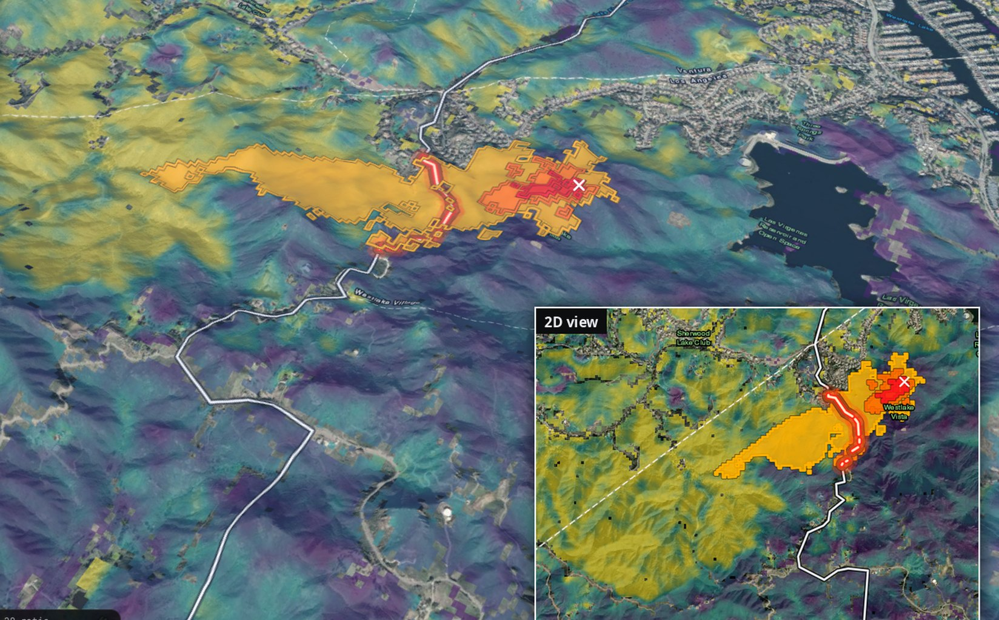
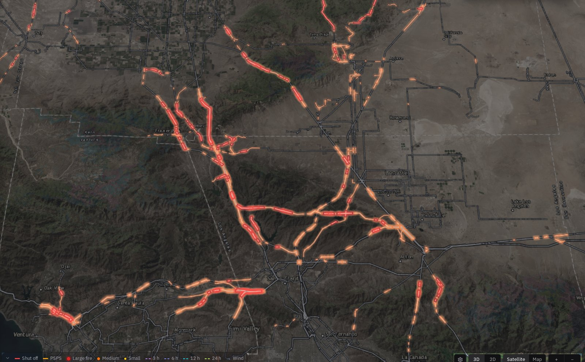
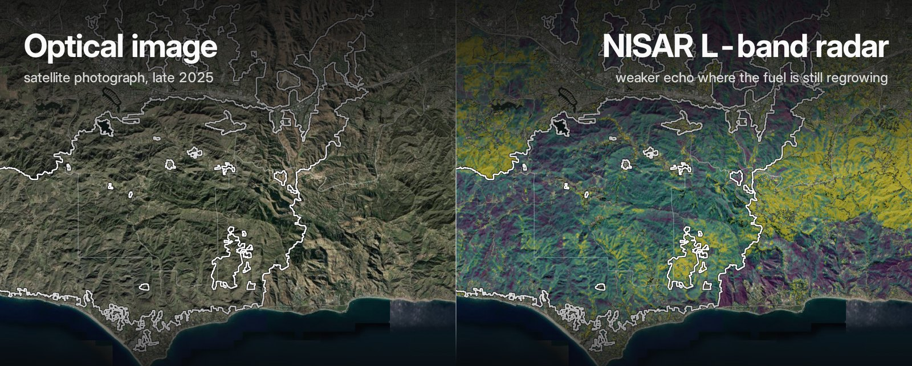
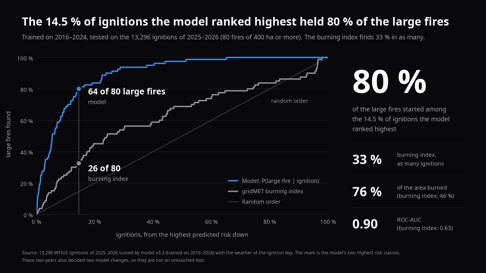
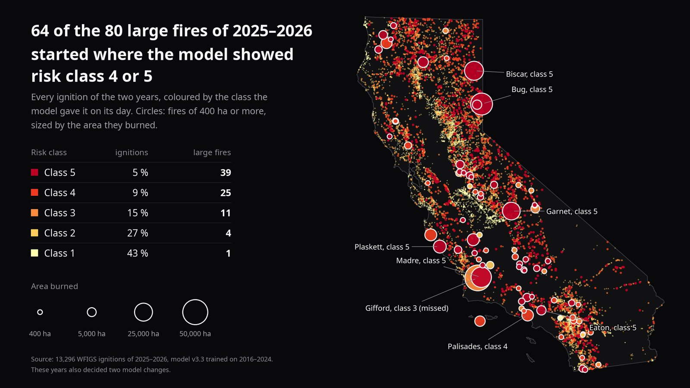

# NASA-ACEs: where would a spark become a large wildfire?

NASA Space Apps 2026, challenge "Dancing with the SARs".

A utility switches power lines off when a spark could become a large fire. That decision needs to know where
fuel is ready to carry fire, at the scale of a slope, today. This project maps it: for every 200 m cell of
California and every day, the chance that an ignition grows to 400 ha or more, split into what the land
contributes and what the day's weather does, with the direction and growth of a fire from any point. NISAR's
L-band radar adds what optical satellites and fuel maps no longer show: the state of the fuel years after a fire,
and soil dryness at 200 m.

## In pictures


*Six hours of fire growth from one ignition in the 2018 Woolsey scar, drawn on the fuel state from NISAR's L-band radar (yellow: mature fuel, purple: regrowth). Red, orange, amber: burned after 1, 3, 6 h. The glowing section is the transmission line the fire reaches.*


*Every transmission line north of Los Angeles, coloured every 200 m by large-fire risk on 20 October 2026: red and orange are the two highest classes (4,481 of 40,730 km statewide).*


*Optical image (left) and NISAR L-band fuel state (right) over the Woolsey and Hill fires of 2018: the radar still separates regrowth from mature fuel (detection 0.89 against 0.65 for optical greenness).*


*On 13,296 ignitions of 2025–2026 the model never saw: the 14.5 % it ranked highest held 64 of the 80 large fires; the standard fire-weather index 26.*



All benchmarks with intervals: [`BENCHMARKS.md`](BENCHMARKS.md). Screenshots were made with Esri World Imagery and World Elevation under the attribution shown in the app.

## What is here

| Directory | Contents |
|---|---|
| [`data-aggregation/`](data-aggregation/) | fuel-lake: connectors and a STAC data lake for NISAR SME2 and GCOV, SMAP L4, gridMET, HRRR, LANDFIRE, fire perimeters, ignitions and field samples of live fuel moisture |
| [`machine-learning/`](machine-learning/) | the models (live fuel moisture, probability of a large fire, fuel age, Rothermel spread, fire-growth simulator), the map writer, validation and the study reports behind each choice |
| [`backend/`](backend/) | FastAPI service that serves the map bundles: tiles, values at a point, fire growth, risk along power lines |
| [`frontend/`](frontend/) | React app: map, layers, fire-growth tool, demo scenarios (map rendering: ArcGIS Maps SDK for JavaScript, see below) |

Start with [`machine-learning/docs/MODEL.md`](machine-learning/docs/MODEL.md): the model on one page, with the
evidence for each part. Methods and limits: [`METHODS.md`](machine-learning/docs/METHODS.md). Every study,
including the ones that failed: [`EXPERIMENTS.md`](machine-learning/docs/EXPERIMENTS.md).

## Results

The model is trained on the ignitions of 2016–2024 (74,568, of which 477 became large fires) and tested on the
13,296 ignitions of 2025–2026, which it never saw.

| On 2025–2026 | Model | gridMET burning index |
|---|---|---|
| Large fires among the 14.5 % of ignitions ranked highest | 64 of 80 | 26 of 80 |
| Share of the area burned among those ignitions | 76 % | 47 % |
| ROC-AUC | 0.90 | 0.63 |
| Large fires expected, 80 observed | 87 | |

Each year of 2016–2024 predicted by models that did not see it: PR-AUC 0.082 against 0.014 for the burning
index.

What NISAR contributes:

- **GCOV, L-band backscatter.** It separates regrowth from mature chaparral 7.5 years after a fire (detection
  0.89; optical greenness 0.65; the 2025 fuel map 0.58). It gives a fuel-state layer and scales the woody fuel of
  the spread physics.
- **SME2, soil moisture at 200 m.** A test written down before the 2026 fire-season scenes were downloaded: a
  pixel drier than its own NISAR record had more fires that grew (AUC 0.55 [0.52, 0.58]; the same measure from
  SMAP 0.45). The 200 m detail alone did not pass that test.

Limits, stated where they matter in the docs: the ranking skill comes from weather, wind gusts, terrain, fuels
and the surroundings of the ignition, not measurably from NISAR yet; the years 2025–2026 also decided two model
changes; scaling fuel by L-band power is an assumption that no fire has tested yet
([`bryson-fire.md`](machine-learning/docs/research/bryson-fire.md)); the fire-growth tool shows potential under
one wind, without suppression, and does not predict fire size.

## Run

Each directory has its own README. In short:

```bash
# data: connectors and the lake (needs a NASA Earthdata token for NISAR)
cd data-aggregation && uv sync && uv run fuellake datasets

# models and the map (uses fuel-lake from ../data-aggregation)
cd machine-learning && scripts/run.sh setup data train map

# backend, serving the map bundles
cd backend && pip install -r requirements.txt && RESULTS_DIR=/path/to/bundles uvicorn app.main:app

# frontend
cd frontend && npm ci && BACKEND_URL=http://127.0.0.1:8000 npm run dev
```

Data, models and map bundles are not in the repository.

## Third-party software and data sources

- **Map rendering library:** the frontend draws the map with the ArcGIS Maps SDK for JavaScript (`@arcgis/core`, `@arcgis/map-components`, `@esri/calcite-components`). It is proprietary, free to use without an API key, under the Esri Master License Agreement; "Powered by Esri" stays visible in the app. It is used only as a renderer: the app calls no Esri-hosted basemap, elevation or Living Atlas service. Replacing it with an open-source renderer (MapLibre GL) is the first item after the hackathon.
- **Open data the app loads:** imagery and labels from USGS The National Map; fire perimeters from NIFC WFIGS; active fires from NASA FIRMS (VIIRS); states and places from Census TIGERweb; forest types from USFS; NISAR, SMAP, gridMET, HRRR, LANDFIRE, FPA-FOD and CAL FIRE FRAP in the models.
- **Still to replace:** the transmission-line layer is read from a hosted copy of the HIFLD electric transmission lines on ArcGIS Online; the open copy on Source Cooperative (CC BY 4.0) is the planned replacement.
- **Earlier screenshots and films** in the presentation were made with Esri World Imagery and World Elevation, with their attribution visible in each image.

## Licence

MIT ([`LICENSE`](LICENSE)), except `machine-learning/` and `data-aggregation/`, which are under Apache-2.0 (their
own `LICENSE` files). Data keep the licences of their providers; required attributions are in
[`data-aggregation/README.md`](data-aggregation/README.md).
